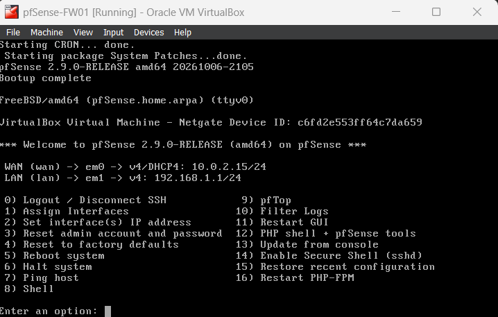
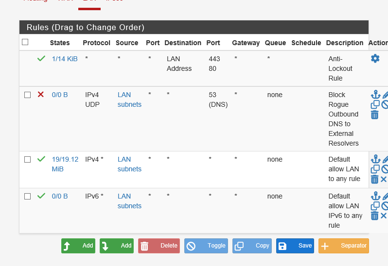
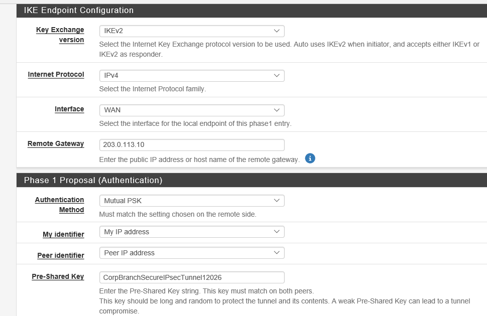
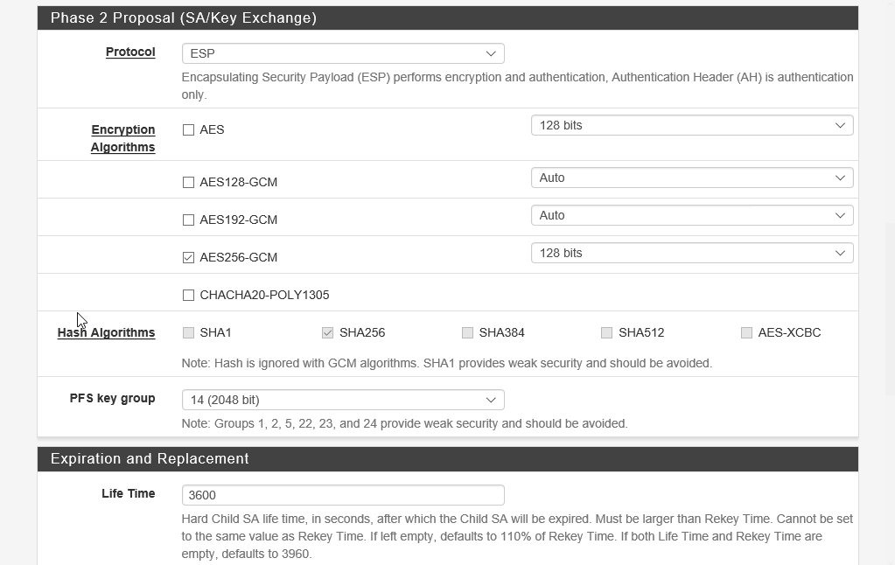
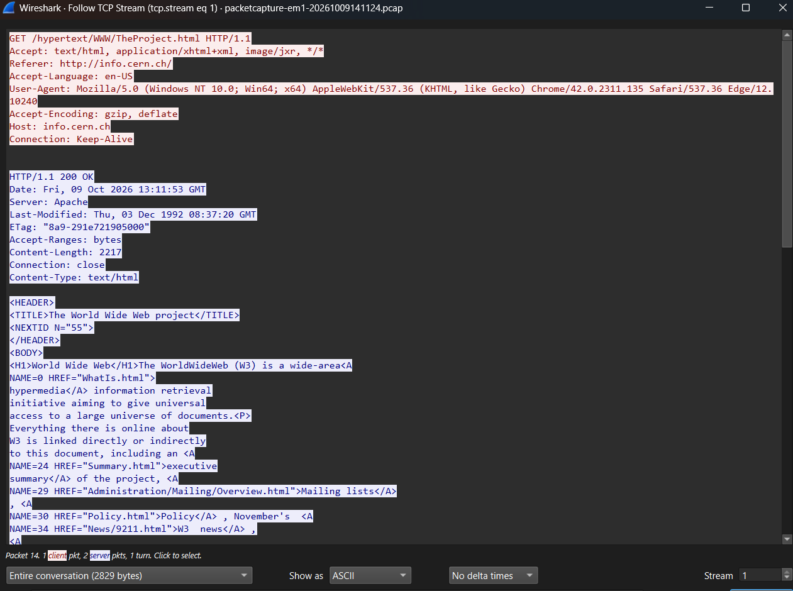
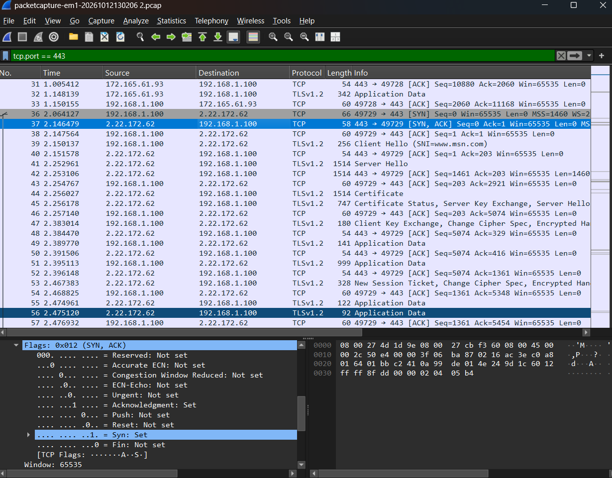
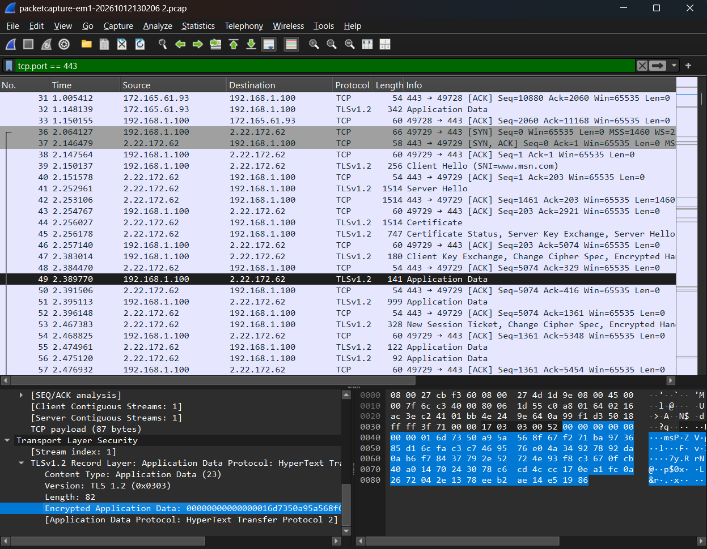

# Enterprise Perimeter Defense: pfSense Firewall, Site-to-Site IPsec VPN (IKEv2) & Wireshark Cryptographic Packet Inspection

[](https://www.pfsense.org/)
[](https://en.wikipedia.org/wiki/IPsec)
[](https://en.wikipedia.org/wiki/Galois/Counter_Mode)
[](https://www.wireshark.org/)
[](https://github.com/ChukwubuzorPerazim)

---

## 1. Executive Summary & Problem Statement

Modern enterprise networks require robust perimeter defense to safeguard private internal infrastructure from adversarial probing, unauthorized lateral traversal, and unencrypted data interception across untrusted public networks. 

This project implements an enterprise **Perimeter Defense & Secure Inter-Site Architecture** utilizing the **pfSense Community Edition (CE 2.9.0)** enterprise firewall and the **Wireshark** network packet analysis engine. It configures stateful egress filtering, architects an **IEEE RFC-compliant Site-to-Site IPsec IKEv2 tunnel** with AES-256-GCM encryption, and conducts forensic packet captures validating the **TCP 3-way handshake**, **TLS cryptographic handshakes**, and the severe vulnerabilities of cleartext HTTP transport.

### Key Objectives Accomplished:
* **Dual-Homed Firewall Deployment:** Provisioned and baselined a dual-interface pfSense firewall (`FW01`) separating untrusted WAN egress from an isolated internal network (`192.168.1.0/24`).
* **Stateful Egress & DNS Filtering:** Enforced default-deny ingress and deployed strict outbound rules terminating rogue outbound DNS traffic (UDP port 53) to eliminate data exfiltration and rogue resolvers.
* **Site-to-Site IPsec VPN Architecture (IKEv2):** Engineered Phase 1 (IKEv2) authentication using Diffie-Hellman Group 14 (2048-bit) and SHA-256, alongside Phase 2 (ESP) transport using `AES256-GCM` with Perfect Forward Secrecy (PFS).
* **Packet Capture & Cryptographic Telemetry:** Analyzed live frames in Wireshark, dissecting the TCP 3-way handshake (`SYN`, `SYN-ACK`, `ACK`), evaluating TLS 1.2/1.3 session negotiations, and exposing cleartext payload hazards.

---

## 2. Infrastructure Architecture & Topology

```
                  [ Untrusted Public WAN / VirtualBox NAT ]
                                     |
                                     | WAN Interface (DHCP / Public IP)
                                     v
                        +------------------------+
                        |  pfSense Firewall FW01 |
                        |   FreeBSD 64-bit OS    |
                        |   WAN: Dynamic Egress  |
                        |   LAN: 192.168.1.1/24  |
                        |   Stateful Packet Insp |
                        |   IPsec IKEv2 Gateway  |
                        +-----------+------------+
                                    |
                                    | LAN Interface (pfSense-LAN)
                                    | Subnet: 192.168.1.0/24
                                    v
                        +------------------------+
                        |  Internal Workstation  |
                        |       CORP-CLO1        |
                        |   IP: 192.168.1.100    |
                        |   Gateway: 192.168.1.1 |
                        |   Wireshark Captures   |
                        +------------------------+
```

### Addressing & Cryptographic Parameter Matrix

| Component | Interface / Tunnel | IP Configuration | Encryption / Hash | DH Group / Key Size |
| :--- | :--- | :--- | :--- | :--- |
| **pfSense FW01** | WAN Interface | Dynamic DHCP (Outbound NAT) | Stateful Inspection | Default Deny Inbound |
| **pfSense FW01** | LAN Interface | `192.168.1.1/24` (Static) | Internal Gateway | DHCP Pool: `.100–.200` |
| **IPsec Phase 1** | IKEv2 Tunnel Auth | Remote Gateway: `203.0.113.10` | AES-256 / SHA-256 | DH Group 14 (2048-bit) |
| **IPsec Phase 2** | ESP Data Tunnel | Local: `192.168.1.0/24` <br> Remote: `192.168.2.0/24` | AES256-GCM (128-bit ICV) | PFS Group 14 (2048-bit) |
| **CORP-CLO1** | Virtual Ethernet | `192.168.1.100` (DHCP) | Gateway: `192.168.1.1` | Wireshark Monitor Host |

---

## 3. Implementation Walkthrough

### Phase 1: pfSense Virtual Firewall Provisioning & Baselining
1. Provisioned virtual firewall appliance `pfSense-FW01` (1 GB RAM, 1 vCPU, 8 GB VHD) in Oracle VM VirtualBox.
2. Configured hardware interfaces:
   * **Adapter 1 (WAN):** Attached to NAT for outbound public connectivity.
   * **Adapter 2 (LAN):** Attached to isolated Internal Network (`pfSense-LAN`).
3. Assigned static IPv4 configuration on LAN interface (`192.168.1.1/24`) and initialized internal DHCP service (`192.168.1.100`–`192.168.1.200`).
4. Completed post-installation configuration via WebGUI (`https://192.168.1.1`): Hostname `fw01.corp.local`, DNS forwarders (`1.1.1.1`, `8.8.8.8`), and hardened administrator credentials.

### Phase 2: Egress Security Rules & Rogue DNS Termination
Configured directional packet filtering under **Firewall > Rules > LAN**:
* Created top-priority block rule dropping outbound UDP traffic on destination port 53 (`LAN net -> any:53`), blocking malware from initiating unauthenticated DNS tunnels or contacting rogue public resolvers.

### Phase 3: Site-to-Site IPsec VPN Architecture (IKEv2)
Configured enterprise tunnel parameters under **VPN > IPsec**:
1. **Phase 1 Proposal (IKEv2):**
   * Protocol: `IKEv2` | Interface: `WAN` | Key Exchange: `Mutual PSK`
   * Cipher: `AES` (256-bit) | Hash: `SHA256` | Diffie-Hellman Group: `14 (2048-bit)`
   * Lifetime: `28800` seconds (8 hours).
2. **Phase 2 Proposal (ESP Data Tunnel):**
   * Mode: `Tunnel IPv4` | Protocol: `ESP`
   * Local Network: `LAN subnet (192.168.1.0/24)`
   * Remote Network: `192.168.2.0/24` (Simulated Branch Subnet)
   * Encryption: `AES256-GCM` (128-bit ICV) | Perfect Forward Secrecy: `Group 14`
   * Lifetime: `3600` seconds (1 hour).

### Phase 4: Protocol Analysis with Wireshark
1. Dissected cleartext transport hazards by executing packet captures against unencrypted HTTP traffic (`http://neverssl.com`), reconstructing cleartext HTML and headers via `Follow TCP Stream`.
2. Captured and evaluated the **TCP 3-Way Handshake** (`SYN`, `SYN-ACK`, `ACK`) establishing stateful transport.
3. Dissected the **TLS Handshake**, inspecting cipher negotiation (`Client Hello` / `Server Hello`), server certificate presentation, and subsequent symmetric application data encryption.

---

## 4. Verification & Testing Evidence

### Test 1: pfSense Executive Dashboard & Interface Telemetry


*Figure 1: pfSense 2.9.0-RELEASE FreeBSD kernel console displaying verified dual-homed interface assignments: WAN (`em0` via DHCP `10.0.2.15/24`) and LAN (`em1` via Static `192.168.1.1/24`).*

---

### Test 2: Firewall Rules & Outbound DNS Egress Filtering


*Figure 2: Firewall Rules on the LAN interface confirming active enforcement and correct top-down rule ordering: Outbound UDP Port 53 block rule positioned directly above the default allow rule to intercept and drop rogue external DNS queries before general egress.*

---

### Test 3: IPsec IKEv2 Phase 1 Configuration Status


*Figure 3: IPsec Phase 1 configuration confirming IKEv2 exchange protocol, WAN interface binding, remote gateway (`203.0.113.10`), Mutual PSK authentication, and IP address peer identification.*

---

### Test 4: IPsec ESP Phase 2 Encryption Proposal


*Figure 4: IPsec Phase 2 configuration establishing an Encapsulating Security Payload (ESP) data tunnel utilizing hardware-accelerated AES256-GCM (128-bit ICV), SHA256 integrity hashing, and PFS Group 14 (2048-bit).*

---

### Test 5: Wireshark Cleartext HTTP Exposure Forensic Analysis


*Figure 5: Wireshark packet capture displaying raw, unencrypted HTTP payload reconstructed via Follow TCP Stream against CERN web server (`info.cern.ch`), exposing cleartext vulnerability (HTTP GET request and unencrypted HTML markup) to sniffing attacks.*

---

### Test 6: Wireshark Stateful TCP 3-Way Handshake Inspection


*Figure 6: Wireshark frame sequence displaying the sequential TCP 3-way handshake on port 443: SYN (Packet 36), SYN-ACK (Packet 37 with expanded control flags `Syn=1`, `Ack=1`), and ACK (Packet 38).*

---

### Test 7: Wireshark Encrypted TLS Session Handshake


*Figure 7: Wireshark inspection of the TLS 1.2 cryptographic session showing Client Hello (SNI `www.msn.com`), Server Hello, Certificate exchange, and dissecting Packet 49 to confirm encrypted Application Data payload.*

---

## 5. Security & Engineering Considerations

1. **Cryptographic Advantage of IKEv2 over IKEv1:**  
   IKEv2 requires fewer round-trip message exchanges (4 messages vs. up to 9 in IKEv1), provides native support for asymmetric authentication, eliminates legacy aggressive-mode vulnerabilities, and features native Dead Peer Detection (DPD).
2. **Galois/Counter Mode (GCM) Efficiency:**  
   `AES256-GCM` provides authenticated encryption with associated data (AEAD). It computes confidentiality and integrity in a single hardware-accelerated pass, significantly outperforming legacy AES-CBC + HMAC-SHA combinations.
3. **Egress Filtering Importance in Cyber Defense:**  
   Most corporate breaches succeed not because perimeter ingress was vulnerable, but because outbound egress was completely unmonitored. Restricting egress DNS to designated forwarders breaks Command & Control (C2) callback beacons.

---

## 6. Author Information

* **Engineer:** Chukwubuzor Perazim
* **Specialization:** Network Security, Windows Server Infrastructure & Command and Control (C3) Systems
* **Location:** Warri, Delta State, Nigeria
* **LinkedIn:** [linkedin.com/in/ChukwubuzorPerazim](https://www.linkedin.com/in/chukwubuzor-perazim-590a5519a/)
* **GitHub:** [github.com/ChukwubuzorPerazim](https://github.com/Perazimy)
